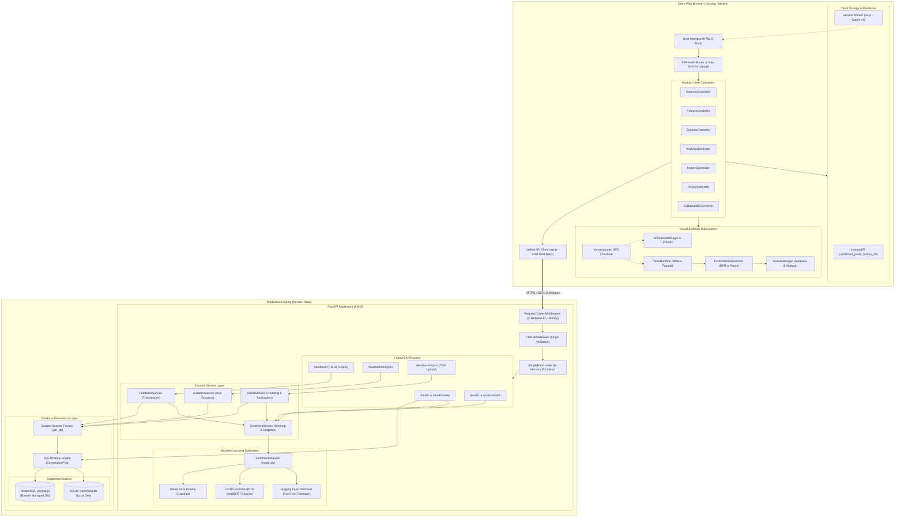
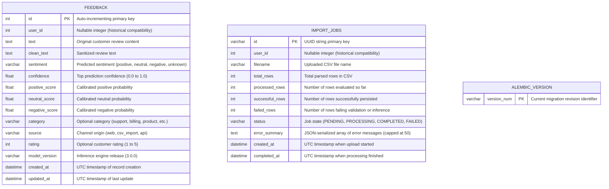
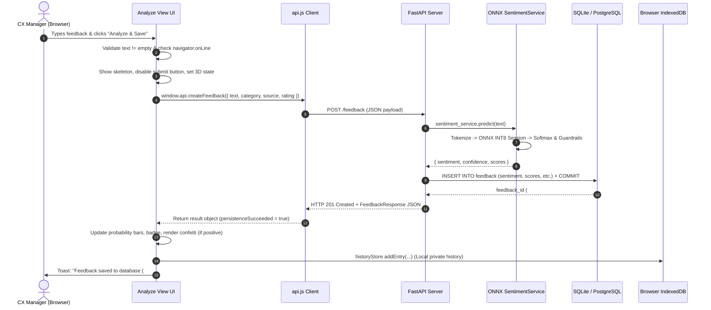

# Sentiment Pulse — End-to-End Project Study Guide, Architecture Deep Dive & Upgrade Readiness Audit

**Document Version:** 1.0.0  
**Audit Target:** Sentiment Pulse — Customer Feedback Intelligence Platform (`v2.0.0` Application / `v3.0.0` Model Engine)  
**System Scope:** Frontend SPA (Vanilla JS + ES Modules + Three.js + GSAP), Backend (FastAPI + Pydantic v2 + SQLAlchemy 2.0), Machine Learning (INT8 DistilBERT ONNX Runtime), Database (SQLite / PostgreSQL Dialects + Alembic), Deployment (Render PaaS)  
**Author Role:** Senior Software Architect, Full-Stack Engineering Mentor, Application Reliability Engineer, and Technical Documentation Specialist  
**Execution Mode:** Pure Read-Only Audit & Evidence-Grounded Educational Study Guide  

---

## Table of Contents

1. [Project Overview and Purpose](#1-project-overview-and-purpose)
2. [Executive Architecture Summary](#2-executive-architecture-summary)
3. [Verified Repository Structure](#3-verified-repository-structure)
4. [Technology Stack and Dependency Inventory](#4-technology-stack-and-dependency-inventory)
5. [System Architecture Diagram](#5-system-architecture-diagram)
6. [Component Responsibility Map](#6-component-responsibility-map)
7. [Frontend Architecture](#7-frontend-architecture)
8. [Backend Architecture](#8-backend-architecture)
9. [API Inventory and Request Lifecycle](#9-api-inventory-and-request-lifecycle)
10. [Database Schema and Persistence Lifecycle](#10-database-schema-and-persistence-lifecycle)
11. [Machine-Learning Architecture](#11-machine-learning-architecture)
12. [Analytics and Feedback Workflows](#12-analytics-and-feedback-workflows)
13. [Animation and Motion Architecture](#13-animation-and-motion-architecture)
14. [Hybrid 3D Rendering Architecture](#14-hybrid-3d-rendering-architecture)
15. [PWA, Caching, and Offline Behavior](#15-pwa-caching-and-offline-behavior)
16. [Security and Reliability Findings](#16-security-and-reliability-findings)
17. [Testing and Performance Findings](#17-testing-and-performance-findings)
18. [Deployment and Production Lifecycle](#18-deployment-and-production-lifecycle)
19. [Important Design Decisions and Trade-offs](#19-important-design-decisions-and-trade-offs)
20. [Verified Defects, Gaps, and Technical Debt](#20-verified-defects-gaps-and-technical-debt)
21. [End-to-End Debugging Playbook](#21-end-to-end-debugging-playbook)
22. [Source-Code Reading Order](#22-source-code-reading-order)
23. [Glossary](#23-glossary)
24. [Twenty-Question Knowledge Check and Answer Key](#24-twenty-question-knowledge-check-and-answer-key)
25. [Prioritized Upgrade Readiness Assessment](#25-prioritized-upgrade-readiness-assessment)
26. [Step-by-Step Learning Roadmap](#26-step-by-step-learning-roadmap)
27. [Final Recommendation](#27-final-recommendation)

---

## 1. Project Overview and Purpose

### 1.1 The Business and Domain Problem
Organizations ingest hundreds or thousands of pieces of customer feedback every week—support tickets, public store reviews, NPS survey comments, product onboarding notes, and customer emails. Typically, companies face three suboptimal choices:
1. **Manual categorization:** Support and product managers read text individually in spreadsheets, leading to human fatigue, inconsistent sentiment scoring, and multi-day delays.
2. **Third-party LLM APIs (OpenAI/Anthropic):** Making remote API calls for every review incurs ongoing operational costs ($0.002–$0.02 per review), introduces unpredictable latency (400ms–2500ms), and exposes raw customer data across third-party boundaries.
3. **Heavy GPU infrastructure:** Self-hosting standard PyTorch/Transformer containers requires expensive cloud GPU nodes ($100–$500/month) and heavy container images (3GB–8GB).

### 1.2 What Sentiment Pulse Solves
**Sentiment Pulse** is a lightweight, self-contained Customer Feedback Intelligence Platform. It combines:
* **Cost-Free, Ultra-Low-Latency CPU Inference:** An INT8 dynamically quantized DistilBERT model running on **ONNX Runtime** with pure C++/Rust tokenization. Single review inference executes in **<25ms** on a commodity CPU, consumes **<90MB RAM** at runtime, and requires zero GPU hardware.
* **Unified Workspace:** A single-page application (SPA) providing real-time single review analysis, sequential chunked bulk review evaluation (up to 100 rows), paginated feedback exploration, interactive customer sentiment trend analytics, and CSV batch ingestion.
* **Dual Persistence Model:** Server-side SQL persistence (SQLite for local development, managed PostgreSQL on Render in production) for shared business analytics, coupled with client-side browser IndexedDB for local private analysis history.
* **Resilient Offline Architecture:** Progressive Web App (PWA) with a versioned Service Worker (`v4`) that caches the entire application shell and vendor assets, allowing offline history inspection and visual feedback when network connectivity is disrupted.

---

## 2. Executive Architecture Summary

### 2.1 Core Architectural Principles (Verified vs Documented)
The codebase adheres strictly to the following foundational engineering decisions:
1. **Vanilla JavaScript Single-Page Application (SPA):** No React, Vue, Angular, or Svelte. The browser shell is pure HTML5 and ES2022 JavaScript organized as modular ES6 imports and specialized controllers.
2. **Zero Runtime Frontend npm Dependencies:** Although `package.json` contains dependencies and devDependencies (`eslint`, `prettier`, `tailwindcss`, `three`), the frontend served to client browsers runs with **zero npm runtime packages**. All client libraries (Three.js, GSAP, Chart.js, Confetti, SplitType, CountUp) are **self-hosted static assets** in `static/js/lib/vendor/` with cryptographically verified Subresource Integrity (SRI) SHA-384 hashes.
3. **No Mandatory Frontend Runtime Build Step:** The FastAPI backend serves the application shell (`templates/index.html`) and static assets directly. There is no Webpack, Vite, or Rollup runtime bundler executing during server start or deployment. Tailwind CSS is pre-compiled ahead of time into a static 37.8KB minified file (`static/css/tailwind.min.css`).
4. **FastAPI Backend:** Built with FastAPI, Pydantic v2 validation models, SQLAlchemy 2.0 ORM, and Alembic database migrations.
5. **Decoupled Architecture:** Authentication and user-isolation mechanisms were intentionally removed (verified via commit `75079bd` and migration `c4e2f187a912`), transitioning the tool from an authenticated multi-user SaaS into an open, friction-free intelligence workspace.

---

## 3. Verified Repository Structure

```text
D:\My_DL_1\
├── .env.example                     # Environment template defining DB URLs, pool sizes, and limits
├── .gitignore                       # Git ignore rules for venv, pycache, node_modules, and databases
├── .prettierignore / .prettierrc    # Prettier configuration for code formatting
├── alembic.ini                      # Alembic CLI configuration mapping to alembic/
├── check_handwritten.py             # Diagnostic test script running 84 linguistic sanity checks
├── database.py                      # Backward-compatibility facade re-exporting db/session and db/models
├── eslint.config.js                 # Flat ESLint configuration enforcing browser/Node global standards
├── evaluate_onnx.py                 # Offline evaluation script testing ONNX accuracy on data/test.csv
├── main.py                          # ASGI application entry point, lifespan, CORS, middleware assembly
├── manifest.webmanifest             # PWA web application manifest (icons, standalone display, theme color)
├── model.py                         # SentimentAnalyzer singleton, ONNX session, and gibberish guardrails
├── model_metrics.json               # Recorded evaluation metrics from trained ONNX checkpoint v3.0.0
├── package.json / package-lock.json # Frontend dev tooling (ESLint, Prettier, Tailwind) and vendor lockfile
├── prepare_data.py                  # Training dataset download and 3-class label mapping pipeline
├── render.yaml                      # Render Blueprint infrastructure-as-code specification
├── requirements.txt                 # Production Python dependencies (FastAPI, ONNX Runtime, SQLAlchemy)
├── requirements-train.txt           # Offline training dependencies (PyTorch, Transformers, Datasets)
├── sentiment.db                     # Local development SQLite database (1,382 feedback records, 72 import jobs)
├── sentiment_model.onnx             # Quantized INT8 DistilBERT ONNX neural network weights (67.4 MB)
├── tailwind.config.js               # Tailwind CSS theme configuration (custom fonts, pulse colors)
├── test_api.py                      # Unittest integration suite for core API endpoints
├── test_model.py                    # Unittest suite for ONNX SentimentAnalyzer in isolation
├── train_model.py                   # Legacy scikit-learn training script (superseded by train_onnx.py)
├── train_onnx.py                    # PyTorch DistilBERT fine-tuning, dynamic INT8 quantization, and export
│
├── alembic/                         # Database schema migration environment
│   ├── env.py                       # Alembic environment configuring dynamic URL and reflection
│   └── versions/                    # Versioned migration history (4 revision scripts)
│
├── api/                             # API routing layer
│   └── routes/
│       ├── analytics.py             # /feedback/analytics routes for BI metrics and trends
│       ├── feedback.py              # /feedback routes for CRUD, pagination, filtering, export
│       ├── health.py                # /health, /health/live, /health/ready probe endpoints
│       ├── imports.py               # /feedback/import routes for bounded CSV upload and job polling
│       └── predictions.py           # /predict and /predict/batch stateless ML inference endpoints
│
├── core/                            # Cross-cutting foundational services
│   ├── config.py                    # Centralized Pydantic Settings & environment variable parsing
│   ├── logging.py                   # Structured log formatting, request ID injection, credential redaction
│   ├── middleware.py                # Starlette RequestContextMiddleware (X-Request-ID, X-Process-Time)
│   └── security.py                  # Sliding-window in-memory IP rate limiter and client IP extractor
│
├── data/                            # Offline dataset splits (Yelp Review Full 3-class partition)
│   ├── train.csv / val.csv / test.csv
│
├── db/                              # Database persistence layer
│   ├── models.py                    # SQLAlchemy declarative models (Feedback, ImportJob)
│   └── session.py                   # Connection pooling, engine binding, and self-healing schema migrator
│
├── reports/                         # Architectural baselines, Lighthouse reports, and handoff documentation
│   └── FINAL_HANDOFF_REPORT.md      # Summary of previous frontend modernization phases
│
├── schemas/                         # Pydantic v2 request/response validation schemas
│   ├── analytics.py                 # FeedbackAnalyticsResponse, SentimentTrendPoint, CategoryBreakdown
│   ├── feedback.py                  # FeedbackCreate, FeedbackResponse, FeedbackListResponse
│   ├── health.py                    # HealthResponse, ReadinessResponse
│   ├── import_job.py                # ImportJobResponse
│   └── prediction.py                # SentimentRequest, SentimentResponse, BatchSentimentRequest
│
├── scripts/                         # Developer automation scripts
│   └── audit-vendor.js              # Node.js SRI hash verification against static vendor assets
│
├── services/                        # Business logic and domain service layer
│   ├── analytics_service.py         # Aggregation engine for trends, polarity, and distributions
│   ├── feedback_service.py          # Feedback persistence, filtering, pagination, and deletion
│   ├── import_service.py            # CSV stream parsing, chunked ingestion, and formula sanitization
│   └── sentiment_service.py         # Singleton wrapper around model.SentimentAnalyzer with warmup
│
├── static/                          # Static web assets served by FastAPI
│   ├── manifest.webmanifest         # PWA manifest file
│   ├── theme.js                     # Dark/light theme initialization and listener
│   ├── css/                         # CSS stylesheets (Tailwind, motion tokens, skeletons, custom UI)
│   │   ├── app.css                  # Custom SaaS layout, badge gradients, and scrollbar styles
│   │   ├── motion-tokens.css        # CSS custom properties for spring easings, durations, and blur
│   │   ├── skeletons.css            # Shimmer loading placeholders and accessibility overrides
│   │   ├── tailwind-input.css       # Tailwind source directive input
│   │   └── tailwind.min.css         # Pre-compiled, minified production Tailwind stylesheet (37.8 KB)
│   ├── icons/                       # PWA application icons (192x192, 512x512, maskable variants)
│   └── js/                          # Modular frontend JavaScript application
│       ├── analytics.js             # Analytics view controller and Chart.js chart manager
│       ├── analyze.js               # Single and bulk feedback analysis controller
│       ├── api.js                   # Unified fetch API client with cold-start retry logic
│       ├── app.js                   # Main SPA router, toast dispatcher, and confirmation modal
│       ├── explain.js               # Client-side word influence perturbation module
│       ├── explorer.js              # Feedback table pagination, filter, and detail modal controller
│       ├── history.js               # Browser-local history UI controller
│       ├── imports.js               # CSV file upload and polling controller
│       ├── overview.js              # KPI summary cards and executive overview controller
│       ├── sw.js                    # Service Worker (Cache v4, offline shell, network-first navigation)
│       ├── 3d/                      # Hybrid 3D WebGL subsystem (Three.js)
│       │   ├── three-runtime.js     # Top-level 3D coordinator facade
│       │   ├── core/                # Camera rig, fallback controller, performance governor, renderer
│       │   └── scenes/              # Scene implementations (overview-scene.js, analyze-scene.js)
│       └── lib/                     # Reusable utilities and state adapters
│           ├── bulk.js              # Bulk multiline parser and error formatter
│           ├── chunker.js           # Generic array chunking utility
│           ├── confidence.js        # Confidence score bucket classifier (0–50%, 50–70%, 70–90%, 90–100%)
│           ├── formatters.js        # Date, relative time, and text snippet formatters
│           ├── idb.js               # Promisified IndexedDB wrapper
│           ├── modal.js             # Accessible modal focus trap helper (Tab / Shift+Tab cycling)
│           ├── pwa-helpers.js       # Offline status tracker and URL categorizer
│           ├── store.js             # IndexedDB history store with FIFO 200-entry eviction and memory adapter
│           ├── motion/              # Coordinated animation management (GSAP, presets, reveals, counters)
│           └── vendor/              # Self-hosted vendor libraries and vendor.manifest.json (SRI verified)
│
├── templates/
│   └── index.html                   # Monolithic application shell containing all view markup and modals
│
├── tests/                           # Python backend integration and regression test suites
│   ├── handwritten_samples.py       # 84 test cases + stress tests for linguistic edge cases
│   ├── test_analytics.py            # Analytics aggregation and date-range filtering tests
│   ├── test_feedback_api.py         # Feedback CRUD, search, pagination, and deletion tests
│   ├── test_frontend_assets.py      # Verification of served static assets and removed auth routes
│   ├── test_imports_exports.py      # CSV batch processing and formula injection security tests
│   ├── test_reliability_observability.py # Liveness, readiness, and correlation ID middleware tests
│   └── frontend/                    # Native Node.js frontend unit test suites (246 tests across 20 files)
│
└── tokenizer/                       # Hugging Face Fast Tokenizer assets
    ├── tokenizer.json               # WordPiece vocabulary (20,000 unigrams) and pipeline configuration
    └── tokenizer_config.json        # Tokenizer metadata and special token definitions ([CLS], [SEP], [PAD])
```

### 3.1 Major Directory Purpose and Debugging Entry Points

| Major Directory | Purpose & Contents | Inbound Dependencies | Debugging Entry Point |
| :--- | :--- | :--- | :--- |
| `api/routes/` | HTTP route declarations, query parsing, and response status mapping. | `main.py` includes these routers; routes call `services/`. | Start at the specific route handler in `api/routes/<domain>.py`. |
| `services/` | Business logic, transaction orchestration, and third-party wrappers. | Called by `api/routes/`. Calls `db/models.py`, `model.py`. | Inspect `services/<domain>_service.py` functions and logging statements. |
| `core/` | Configuration, middleware, security, and logging formatters. | Loaded universally by `main.py`, `db/session.py`, `services/`. | Check `core/config.py` for settings and `core/middleware.py` for request context. |
| `db/` | SQLAlchemy models, engine configuration, and schema migrations. | Loaded by `services/` and `main.py`. | Check `db/session.py` for connection issues and `db/models.py` for column types. |
| `static/js/` | Frontend controllers, API communication, and state stores. | Executed by `templates/index.html` in client browsers. | Start in `static/js/app.js` for routing; open browser DevTools console. |
| `static/js/3d/` | Three.js WebGL scenes, camera rig, and GPU performance controls. | Loaded dynamically by `app.js` and view controllers. | Inspect `static/js/3d/three-runtime.js` and `core/performance-governor.js`. |
| `static/js/lib/motion/` | Animation orchestration, micro-interactions, and vendor loading. | Loaded by controllers; manages GSAP, Flip, CountUp, SplitType. | Inspect `static/js/lib/motion/animation.js` and `vendor-loader.js`. |
| `tokenizer/` | WordPiece vocabulary and tokenizer state machine. | Loaded by `model.py` during ONNX engine initialization. | Check `tokenizer/tokenizer.json` existence and token mapping. |

---

## 4. Technology Stack and Dependency Inventory

### 4.1 Production Python Runtime Dependencies (`requirements.txt`)
All versions verified against active `requirements.txt` and verified in virtual environment:

| Dependency | Minimum / Actual Version | Purpose | Criticality | Operational Failure Risk |
| :--- | :--- | :--- | :--- | :--- |
| `fastapi` | `>=0.110.0` (0.115.11) | Core ASGI web framework and routing engine. | Critical | Application fails to start. |
| `uvicorn[standard]` | `>=0.28.0` (0.34.0) | High-performance ASGI production web server. | Critical | Process cannot bind or accept HTTP sockets. |
| `onnxruntime` | `>=1.18.0` (1.20.1) | C++ neural network execution engine for CPU. | Critical | Sentiment analysis and readiness probe fail. |
| `tokenizers` | `>=0.19.0` (0.21.0) | Fast WordPiece text tokenization (Rust-based). | Critical | Text cannot be encoded into tensor input IDs. |
| `sqlalchemy` | `>=2.0.0` (2.0.38) | SQL toolkit and Object Relational Mapper (ORM). | Critical | Database queries and schema migrations fail. |
| `alembic` | `>=1.13.0` (1.14.1) | Database migration tool for versioned DDL. | High | Schema drift between code and production DB. |
| `psycopg[binary]` | `>=3.1.0` (3.2.5) | Modern PostgreSQL database driver for Python. | Critical (Prod) | Production database connectivity failure. |
| `pydantic` | `>=2.6.0` (2.10.6) | Data validation, parsing, and settings management. | Critical | API payloads fail to validate. |
| `jinja2` | `>=3.1.3` (3.1.5) | Server-side template rendering engine. | High | Application shell (`/`) fails to render. |
| `python-multipart`| `>=0.0.9` (0.0.20) | Streaming multipart/form-data parser for CSV. | High | CSV file uploads fail with 422 error. |
| `python-dotenv` | `>=1.0.0` (1.0.1) | Local `.env` file loader for configuration. | Low | Falls back to system environment variables. |
| `numpy` | `>=1.24.0` (2.2.3) | Array operations and softmax probability math. | Critical | Logits cannot be converted to probabilities. |
| `scikit-learn` | `>=1.4.0` (1.6.1) | Evaluation metrics (Accuracy, Macro-F1). | Low (Runtime) | Used only in offline evaluation scripts. |
| `joblib` | `>=1.3.0` (1.4.2) | Serialization utility (legacy dependency). | Low | Residual from v1.0 scikit-learn models. |
| `pytest` | `>=8.0.0` (8.3.4) | Automated testing framework. | Development | Test execution unavailable in production. |

### 4.2 Frontend Self-Hosted Vendor Libraries (`vendor.manifest.json`)
All frontend runtime libraries are self-hosted in `static/js/lib/vendor/` and verified with Subresource Integrity (SRI) SHA-384 hashes:

| Library | Version | File | Verified SHA-384 Integrity Hash | Role in Application |
| :--- | :--- | :--- | :--- | :--- |
| **Three.js Core** | `0.186.1` | `three.core.js` | `sha384-mdKeCwPEcbDvzaxwhm+MVuLoMou+E7jQqrs4tmu/n8HBYPGI1kZt0MkJxlMR4zFM` | WebGL rendering engine, matrix math, geometry. |
| **Three.js Module**| `0.186.1`| `three.module.js`| `sha384-m8JoFX52V6NGv2usipnlLJKnJfL7IE8dbniPDDCSGSQv3Hm4n6PjfV6syVwfuoRc` | ES module bundle for 3D coordinate system. |
| **GSAP** | `3.13.0` | `gsap.min.js` | `sha384-HOvlOYPIs/zjoIkWUGXkVmXsjr8GuZLV+Q+rcPwmJOVZVpvTSXQChiN4t9Euv9Vc` | Core tweening and timeline motion engine. |
| **ScrollTrigger** | `3.13.0` | `ScrollTrigger.min.js` | `sha384-P8VzCVnT9NBUkMrpcIZrJbA7EBjJvh/fJS6PmP+4nLIM284DtsImIv8D0fFjIkeh` | Viewport scroll position animation binder. |
| **Flip** | `3.13.0` | `Flip.min.js` | `sha384-lg3+EgIwmxYq9YD4ix279pdUEasqmOS17fF+2mI/NEg6JHkawYaWYpJ6nKZenPOy` | First-Last-Invert-Play smooth DOM layout transitions. |
| **Chart.js** | `4.4.2` | `chart.min.js` | `sha384-zuFoHkJ6+XzUchVtS39qBWxb+LvdA7aQ/ze8jYdufBf/A1jeuKGDBg4crfxvZAr8` | Visual charts (trends, polarities, distributions). |
| **CountUp.js** | `2.8.0` | `countup.min.js` | `sha384-DsT1q/+aTIkNUICSMoPHLh8RDdgN2BaPm3ThHPGAuETCIdf1vPGwFsoMy/SrKZ7W` | Numerical odometer rolling animations on KPI stats. |
| **SplitType** | `0.3.4` | `split-type.min.js` | `sha384-wQImCCD/id1jPTwSloatzKlEpnEAQ5aH8H2Ud27FnNcJ1lf2+hB75ctoWnWxyD8X` | Text splitting into character/word spans for reveals. |
| **Canvas Confetti**| `1.9.3` | `confetti.min.js` | `sha384-/Ko/tqVwPYurnBe+Mj8WWw+39WmyOZn/kU+neqXn4hRxGI575k07mB/hIekAT51+` | Particle celebration effect on positive predictions. |

---

## 5. System Architecture Diagram



### 5.1 Explanation of Real System Connections
1. **Browser Shell to Router:** When a user navigates or clicks the navigation bar, `app.js` catches the event, updates the URL hash (`#analyze`, `#explorer`), exits active animations, hides the former container, displays the new container, and notifies the target subcontroller.
2. **Subsystem Coordination:** `ThreeRuntime` reparents a single canvas to `#overview-3d-stage` or `#analyze-3d-stage`. If the user navigates to a 2D view (such as `#explorer` or `#import-export`), `PerformanceGovernor.pause()` immediately halts the WebGL render loop, dropping GPU utilization to zero.
3. **Transport Layer:** `api.js` dispatches requests with a default 60-second timeout. If it detects HTTP 502/503 (Render free-tier container spinning up), it displays a friendly toast notice (*"Server is waking up (~50s), retrying..."*) and automatically executes an exponential backoff retry.
4. **FastAPI Pipeline:** Requests traverse `RequestContextMiddleware` (attaching a unique `X-Request-ID` UUID and starting a nanosecond performance counter), pass through CORS origin validation, and hit route handlers.
5. **Inference Coupling:** `POST /predict` calls `sentiment_service.predict()` statelessly. Crucially, `POST /feedback` also calls `sentiment_service.predict()` to calculate sentiment labels and confidence scores before writing the record into the database.
6. **Data Dialect Compatibility:** `db/session.py` inspects the configured connection string. For SQLite, it injects `connect_args={"check_same_thread": False}`; for PostgreSQL, it enables connection pooling (`pool_size=5`, `max_overflow=10`, `pool_recycle=1800`) and normalizes legacy `postgres://` prefixes to `postgresql+psycopg://`.

---

## 6. Component Responsibility Map

| Component | Physical Location | Core Responsibility | Primary Inputs | Primary Outputs | Key Dependencies | Primary Failure Modes & Risks |
| :--- | :--- | :--- | :--- | :--- | :--- | :--- |
| **App Orchestrator** | `static/js/app.js` | SPA routing, view switching, toasts, confirmation dialogs. | Hashchange events, DOM clicks. | Active view toggle, visual transitions. | DOM, `MicroInteractions`, `ThreeRuntime`. | Stale view state if subcontroller throws during switch. |
| **API Client** | `static/js/api.js` | Fetch dispatch, error parsing, cold-start retries. | Endpoint path, HTTP options, body. | Resolved JSON or Blob stream. | Browser `fetch`, `AbortController`. | Unhandled network timeout if backend drops connection. |
| **Sentiment Service** | `services/sentiment_service.py` | Singleton lifecycle, model warmup, inference benchmarking. | Unprocessed text string. | Dictionary (label, confidence, scores). | `model.SentimentAnalyzer`, `core/config.py`. | Memory allocation failure if ONNX weights corrupt. |
| **Sentiment Analyzer** | `model.py` | Tokenization, tensor creation, ONNX execution, guardrails. | Clean string text. | Prediction payload dictionary. | `tokenizers.Tokenizer`, `onnxruntime.InferenceSession`. | False positive gibberish classification on jargon. |
| **Feedback Service** | `services/feedback_service.py` | CRUD operations, multi-criteria filtering, pagination. | DB Session, `FeedbackCreate` schema. | `Feedback` ORM entities. | `db/models.py`, `services/sentiment_service.py`. | Transaction rollback on invalid column data. |
| **Analytics Service** | `services/analytics_service.py` | SQL aggregations, date-bucketed trends, polarity distributions. | DB Session, start/end date filters. | `FeedbackAnalyticsResponse` schema. | SQLAlchemy `func`, `db/models.py`. | Slow table scan query if database scales past 100k rows. |
| **Import Service** | `services/import_service.py` | Stream parsing, bounded chunking, CSV formula sanitization. | DB Session, raw CSV bytes. | `ImportJob` ORM entity, CSV string. | Python `csv`, `io`, `sentiment_service`. | Request timeout on large files (>2,000 rows). |
| **Session Manager** | `db/session.py` | Engine binding, connection pool, self-healing migrations. | `DATABASE_URL` configuration setting. | SQLAlchemy `Session` generator (`get_db`). | SQLAlchemy `create_engine`, `inspect`. | SQLite database lock under concurrent multithreaded writes. |
| **Three Runtime** | `static/js/3d/three-runtime.js` | WebGL facade, stage reparenting, theme/motion coordination. | View change events, telemetry data. | Rendered WebGL canvas buffer. | Three.js vendor bundle, DOM stages. | WebGL context loss on mobile GPU pressure. |
| **Animation Manager** | `static/js/lib/motion/animation.js` | Timeline scheduling, presets, reduced-motion overrides. | Animation trigger, target element. | Executing GSAP tween / CSS animation. | GSAP vendor bundle, `motion-tokens.css`. | Stale animation reference holding DOM node in memory. |
| **Service Worker** | `static/js/sw.js` | Offline shell caching, asset pre-fetching, cache purging. | Browser fetch events. | Cached HTTP response or network stream. | Cache Storage API. | Serving stale static assets if cache version is not bumped. |

---

## 7. Frontend Architecture

### 7.1 Entry Point and Bootstrap Sequence
When a client requests `GET /`, the browser executes the following bootstrap sequence:
1. **Immediate Head Script (FOUC Prevention):** Lines 13–19 of `templates/index.html` execute synchronously before CSS rendering:
   ```javascript
   if (localStorage.getItem('theme') === 'dark' || (!('theme' in localStorage) && window.matchMedia('(prefers-color-scheme: dark)').matches)) {
     document.documentElement.classList.add('dark');
   } else {
     document.documentElement.classList.remove('dark');
   }
   ```
   This prevents the "Flash of Unstyled Content" (FOUC) where a dark-mode user briefly sees a blinding white screen.
2. **Stylesheet Loading:** Pre-compiled Tailwind (`tailwind.min.css`), custom variables (`app.css`), spring motion tokens (`motion-tokens.css`), and shimmer classes (`skeletons.css`) are loaded.
3. **Module & Script Execution:** ES modules in `static/js/lib/` load and attach to `window`. Then, view controllers (`overview.js`, `analyze.js`, `explorer.js`, `analytics.js`, `imports.js`, `history.js`) register on `window`.
4. **App Initialization:** `app.js` runs `App.init()`:
   * Initializes `MicroInteractions.init()`.
   * Invokes `ThreeRuntime.init()`.
   * Binds navigation listeners (desktop sidebar links and mobile drawer buttons).
   * Registers offline detection listeners (`window.addEventListener('online'/'offline')`).
   * Registers the Service Worker (`/static/js/sw.js`).
   * Reads `window.location.hash` and executes `App.switchView(hash || 'overview')`.
   * Initializes all subcontrollers (`AnalyzeController.init()`, `ExplorerController.init()`, etc.).

### 7.2 View Switching and Memory Safety Contract
The application uses a hash-based routing contract:
* When `App.switchView(viewName)` is called, it triggers lifecycle cleanup on the departing view:
  ```javascript
  if (window.AnimationManager) window.AnimationManager.exitView(previousView);
  if (previousView === 'analytics' && window.AnalyticsController?.cleanup) window.AnalyticsController.cleanup();
  if (previousView === 'explorer' && window.ExplorerController?.cleanup) window.ExplorerController.cleanup();
  ```
* **DOM Container Toggling:** All view containers (`#view-overview`, `#view-analyze`, etc.) exist simultaneously in `templates/index.html`. Switching views toggles the Tailwind `hidden` class.
* **Canvas Reparenting:** Rather than creating a separate `<canvas>` element or multiple WebGL contexts for each view (which crashes mobile browsers due to the standard 8-context limit), `ThreeRuntime` detaches its single persistent canvas and re-attaches it to `#overview-3d-stage` or `#analyze-3d-stage`. For views without 3D elements, the render loop is paused.

---

## 8. Backend Architecture

### 8.1 Application Assembly and Lifespan
In `main.py`, FastAPI is instantiated using an `@asynccontextmanager` lifespan handler:
```python
@asynccontextmanager
async def lifespan(app: FastAPI):
    logger.info("Initializing database schema...")
    init_db()
    logger.info("Verifying SentimentAnalyzer inference engine readiness...")
    if not sentiment_service.is_ready():
        sentiment_service._initialize()
    app.state.analyzer = sentiment_service.analyzer
    logger.info("Inference engine ready. Starting API server.")
    yield
    logger.info("Sentiment Pulse application shutting down.")
```
**Benefits:**
* Zero request latency penalty on first user visit: Tables are verified and the ONNX model is warmed up with dummy inference passes before the web server begins accepting incoming HTTP traffic.
* Controlled lifecycle shutdown.

### 8.2 Middleware Pipeline
1. **`RequestContextMiddleware` (`core/middleware.py`):**
   * Inspects incoming headers for `X-Request-ID`. If absent, generates a fresh `uuid.uuid4()`.
   * Stores the ID in a Python `contextvars.ContextVar` (`request_id_ctx`), making the correlation ID automatically accessible to all logging statements across async tasks without manual parameter passing.
   * Measures request execution time with `time.perf_counter()` and returns both `X-Request-ID` and `X-Process-Time` (e.g. `14.20ms`) on the response headers.
2. **`CORSMiddleware` (`main.py`):**
   * Configured via `settings.ALLOWED_ORIGINS` (defaults to `*` in dev, or specific URLs such as `https://sentiment-pulse-app.onrender.com` in production).
3. **Structured Global Exception Handler (`main.py`):**
   * Catches all unhandled server exceptions, logs the full Python traceback accompanied by the correlation `request_id`, and returns a clean, sanitized JSON 500 error containing the `request_id` for user support triage, preventing raw code snippets from leaking to clients.

---

## 9. API Inventory and Request Lifecycle

### 9.1 Verified API Route Inventory

| Method | Endpoint | Description | Request Body / Parameters | Response Schema | Auth | Database Interaction | Error Codes |
| :--- | :--- | :--- | :--- | :--- | :--- | :--- | :--- |
| **GET** | `/` | Serves SPA application shell HTML. | None. | `text/html` (`templates/index.html`). | None | None. | 200 |
| **GET** | `/health` | Uptime check & model evaluation metadata. | None. | `HealthResponse` | None | None. | 200 |
| **GET** | `/health/live` | Lightweight liveness probe for Kubernetes/Render. | None. | `{"status": "alive"}` | None | None. | 200 |
| **GET** | `/health/ready` | Readiness probe checking DB & ONNX model. | None. | `ReadinessResponse` | None | Executes `SELECT 1` & queries `Feedback`. | 200, 503 |
| **POST** | `/predict` | Stateless inference on a single string. | `SentimentRequest` (`text`). | `SentimentResponse` | None | None. | 200, 400, 422, 500 |
| **POST** | `/predict/batch` | Stateless batch inference (up to 50 items). | `BatchSentimentRequest` (`texts: List[str]`). | `BatchSentimentResponse` | None | None. | 200, 422 |
| **POST** | `/feedback` | Analyzes, scores, and persists customer review. | `FeedbackCreate` (`text`, `category`, `rating`, `source`). | `FeedbackResponse` | None | `INSERT INTO feedback`. | 201, 400, 422, 500 |
| **GET** | `/feedback` | Paginated review list with multi-criteria filters. | Query: `page`, `page_size`, `sentiment`, `search`, etc. | `FeedbackListResponse` | None | `SELECT FROM feedback WHERE ... LIMIT ...`. | 200, 422 |
| **GET** | `/feedback/{id}` | Retrieves single feedback record by primary key. | Path: `feedback_id: int`. | `FeedbackResponse` | None | `SELECT FROM feedback WHERE id = :id`. | 200, 404 |
| **DELETE**| `/feedback/{id}` | Deletes a single feedback record by primary key. | Path: `feedback_id: int`. | `{"message": "..."}` | None | `DELETE FROM feedback WHERE id = :id`. | 200, 404 |
| **GET** | `/feedback/stats` | Summary sentiment distribution & counts. | None. | `FeedbackStatsResponse` | None | `SELECT sentiment, count(id) GROUP BY sentiment`. | 200 |
| **GET** | `/feedback/analytics` | Business intelligence metrics & daily trends. | Query: `start_date`, `end_date` (ISO 8601). | `FeedbackAnalyticsResponse` | None | Date-grouped queries on `Feedback`. | 200, 422 |
| **POST** | `/feedback/import`| Uploads CSV file for chunked batch ingestion. | Multipart file upload (`file: UploadFile`). | `ImportJobResponse` | None | `INSERT INTO import_jobs`, `INSERT INTO feedback`. | 202, 400, 413 |
| **GET** | `/feedback/import/{id}` | Polls status and row progress of import job. | Path: `job_id: str` (UUID). | `ImportJobResponse` | None | `SELECT FROM import_jobs WHERE id = :id`. | 200, 404 |
| **GET** | `/feedback/export` | Secure CSV export with formula sanitization. | None. | `text/csv` attachment stream. | None | `SELECT * FROM feedback ORDER BY created_at`. | 200 |

*Note: All `/feedback` and `/predict` endpoints are also aliased under `/api/feedback` and `/api/predict` for full client compatibility.*

---

## 10. Database Schema and Persistence Lifecycle

### 10.1 Entity Relationship Diagram



### 10.2 Table Column Definitions and Indexes

#### `feedback` Table
* `id` (`Integer`, PK, Autoincrement, Indexed)
* `user_id` (`Integer`, Nullable, Indexed): Retained for schema backwards compatibility after auth removal; stores `None` for all new feedback.
* `text` (`Text`, Not Null): Raw customer feedback.
* `clean_text` (`Text`, Nullable): Sanitized text string.
* `sentiment` (`String(20)`, Not Null, Indexed): Sentiment label (`positive`, `neutral`, `negative`, `unknown`).
* `confidence` (`Float`, Not Null): Highest probability score (0.0000–1.0000).
* `positive_score` / `neutral_score` / `negative_score` (`Float`, Not Null, Default `0.0`): Three-class breakdown.
* `category` (`String(50)`, Nullable, Indexed): e.g. `'product'`, `'support'`, `'billing'`.
* `source` (`String(50)`, Nullable, Indexed): e.g. `'web'`, `'csv_import'`, `'api'`.
* `rating` (`Integer`, Nullable): Optional 1–5 customer rating.
* `model_version` (`String(30)`, Not Null, Default `'3.0.0'`).
* `created_at` (`DateTime(timezone=True)`, Not Null, Indexed): UTC timestamp.
* `updated_at` (`DateTime(timezone=True)`, Not Null): UTC timestamp.

#### `import_jobs` Table
* `id` (`String(36)`, PK, Indexed): UUID string.
* `user_id` (`Integer`, Nullable, Indexed).
* `filename` (`String(255)`, Not Null).
* `total_rows` / `processed_rows` / `successful_rows` / `failed_rows` (`Integer`, Default `0`).
* `status` (`String(20)`, Not Null, Indexed): `PENDING` -> `PROCESSING` -> `COMPLETED` / `FAILED`.
* `error_summary` (`Text`, Nullable): JSON array of string errors (capped at 50 entries).
* `created_at` / `completed_at` (`DateTime(timezone=True)`).

### 10.3 Self-Healing Schema Migrations
In `db/session.py` (lines 51–176), `_migrate_schema()` performs an automated runtime reconciliation:
* **SQLite Table Recreation:** SQLite does not support `ALTER TABLE DROP CONSTRAINT`. If `_migrate_schema()` detects a foreign key pointing to the legacy `users` table, it creates `feedback_clean`, copies all data, drops `feedback`, renames `feedback_clean` to `feedback`, and re-creates all six indexes with `PRAGMA foreign_keys = OFF`.
* **PostgreSQL Schema Sync:** On PostgreSQL, it drops the foreign key constraint directly via `ALTER TABLE ... DROP CONSTRAINT IF EXISTS ...` and ensures `ALTER COLUMN user_id DROP NOT NULL`.
* **Alembic Version Alignment:** Automatically ensures the `alembic_version` table is set to the latest migration (`d5f3a1829e01`).

---

## 11. Machine-Learning Architecture

### 11.1 Model Artifacts and Runtime Environment
* **Base Architecture:** DistilBERT (`distilbert-base-uncased`), 6 Transformer layers, 768 hidden dimensions, 12 attention heads.
* **Trained Task:** 3-class sequence classification (`0: negative`, `1: neutral`, `2: positive`).
* **Training Dataset:** Yelp Review Full dataset (`yelp_review_full`), with 1–2 star reviews mapped to negative, 3 star mapped to neutral, and 4–5 star mapped to positive.
* **Model Format:** `sentiment_model.onnx` (67,395,951 bytes / ~67.4 MB).
* **Quantization:** Dynamic INT8 quantization (`onnxruntime.quantization.QuantType.QInt8`). Embeddings and linear layer weights are quantized to 8-bit integers, shrinking model size from ~260MB to 67.4MB with negligible accuracy degradation (<0.5% F1 difference).
* **Tokenizer:** Fast Hugging Face WordPiece tokenizer (`tokenizer/tokenizer.json`, 711 KB), configured with 20,000 unigram tokens. Runs in pure native Rust/C++ without PyTorch dependencies.

### 11.2 Inference Pipeline and Softmax Normalization
In `model.py`, `SentimentAnalyzer.predict(text: str)` executes:
1. **Sanitization:** Strips leading/trailing whitespace. Raises `ValueError` if text is empty.
2. **Tokenization:** `encoding = self._tokenizer.encode(cleaned_text)` generates integer lists for `input_ids` and `attention_mask`.
3. **Tensor Construction:** Converted to 2D NumPy arrays with shape `(1, sequence_length)` and dtype `np.int64`.
4. **ONNX Session Execution:** `outputs = self._session.run(None, ort_inputs)`. Returns raw unnormalized logits of shape `(1, 3)`.
5. **Numerically Stable Softmax:**
   ```python
   exp_logits = np.exp(logits - np.max(logits))
   probabilities = exp_logits / np.sum(exp_logits)
   ```
   Subtracting `np.max(logits)` prevents floating-point overflow during exponentiation.

### 11.3 Guardrails and Classification Thresholds
Standard softmax often produces overconfident predictions on nonsensical input. The model applies two sequential guardrails:
1. **Rule-Based Gibberish Detection (`_is_gibberish` in `model.py:L27-55`):**
   * **WordPiece Fragmentation Check:** If real subword tokens starting with `##` exceed 40% of tokens (for token count $\ge 3$), the text is treated as random characters broken up by the tokenizer.
   * **Phonetic Vowel Check:** If $\ge 30\%$ of words (length $\ge 4$) contain zero vowels (`aeiouy`), it flags keystroke mashing (e.g. `'dfghjk'`, `'zxcvbnm'`).
   * **Consonant Clustering:** Flags regular expression `[bcdfghjklmnpqrstvwxyz]{6,}` (6+ consonants consecutively).
2. **Confidence Thresholding:**
   ```python
   is_gib = _is_gibberish(cleaned_text, encoding.tokens)
   if is_gib or top_sentiment[1] < 0.35:
       sentiment_label = "unknown"
   elif top_sentiment[1] < 0.445:
       sentiment_label = "neutral"
   else:
       sentiment_label = top_sentiment[0]
   ```
   * If flagged as gibberish OR confidence is below 35% ($0.35$): label is forced to `"unknown"`.
   * If confidence is between 35% and 44.5% ($0.445$): labeled as `"neutral"` due to low polarity separation.
   * If confidence exceeds 44.5%: labeled as the highest scoring sentiment class.

---

## 12. Analytics and Feedback Workflows

### 12.1 Single Feedback Analysis and Persistence Workflow
In `static/js/analyze.js`, `AnalyzeController.executeAnalysis()` manages the complete lifecycle:


**Persistence Separation & Fallback:**
* If the user unchecks `"Save to database"`, the frontend calls `POST /predict`. No database record is created.
* If `"Save to database"` is checked but the database write fails (e.g. disk full, connection loss), `analyze.js` catches `saveErr`, logs the error, automatically falls back to `window.api.predict(text)` to obtain sentiment scores, displays the analysis to the user, and shows a warning toast: *"Failed to save feedback. Please try again."*

### 12.2 Analytics Aggregation Workflow
When navigating to `#analytics`, `AnalyticsController.loadAnalytics()` calls `GET /feedback/analytics`:
* Executed by `services/analytics_service.py:AnalyticsService.get_analytics()`.
* **Database Aggregations:**
  * Sentiment counts and percentages grouped by `Feedback.sentiment`.
  * Overall average confidence via `func.avg(Feedback.confidence)`.
  * Temporal daily sentiment trend via `func.date(Feedback.created_at)`.
  * Category and source breakdowns using SQL `GROUP BY`.
  * Surfaces the 10 most recent negative feedback items for immediate churn risk triage.
* **Client Chart Lifecycle:** `AnalyticsController` dynamically loads Chart.js via `VendorLoader.loadVendor('chart')`. It destroys existing `chart.js` instances before re-rendering to prevent canvas reuse errors and memory leaks.

---

## 13. Animation and Motion Architecture

### 13.1 Animation Coordinator and Vendor Loading
All animations are managed through a centralized coordinator in `static/js/lib/motion/`:
* **`vendor-loader.js`:** Loads self-hosted vendor libraries dynamically with SRI hash validation.
* **`animation.js` (`AnimationManager`):** The single entry point for scheduling animations. It inspects `window.matchMedia('(prefers-reduced-motion: reduce)')`. If reduced motion is active, all durations are clamped to 0ms and tweens resolve immediately.
* **`reveal.js` (`RevealEngine`):** Scans the DOM for `data-reveal` and `data-stagger` attributes, applying coordinated entrance animations as elements scroll into the viewport.
* **`counters.js` (`CounterMotion`):** Animates numeric KPI numbers smoothly from 0 to target values using CountUp.js.
* **`micro.js` (`MicroInteractions`):** Handles button press physics, modal zoom transitions, and toast notifications.

---

## 14. Hybrid 3D Rendering Architecture

### 14.1 Coordination and Performance Governance
The 3D subsystem (`static/js/3d/`) renders interactive WebGL scenes using Three.js:
* **`three-runtime.js` (`ThreeRuntime`):** High-level facade that coordinates scenes with application routing.
* **`renderer-manager.js` (`RendererManager`):** Manages a single WebGL renderer and canvas. Uses container reparenting (`RendererManager.attachTo(stage)`) to move the canvas between `#overview-3d-stage` and `#analyze-3d-stage`.
* **`performance-governor.js` (`PerformanceGovernor`):** Tracks frame render durations.
  * Adjusts Device Pixel Ratio (DPR) dynamically between 0.75 and 1.5 to maintain 60 FPS on low-power devices.
  * Calls `SceneManager.stopLoop()` when the browser tab is hidden or when navigating to a 2D view.
* **`fallback-controller.js` (`FallbackController`):** Detects if WebGL is unavailable or if the user has requested reduced motion, automatically replacing 3D stages with elegant 2D CSS gradient badges.
* **2D Brand Mark Independence:** The brand icon in the header (lines 45–96 of `templates/index.html`) is an animated 2D SVG, completely independent of the Three.js 3D subsystem, ensuring the brand mark remains visible even if WebGL fails.

---

## 15. PWA, Caching, and Offline Behavior

### 15.1 Service Worker Strategy (`static/js/sw.js`)
* **Cache Identifier:** `sentiment-pulse-shell-v4`.
* **Pre-cached Shell Assets:** 72 local files pre-cached on install (HTML shell, CSS, JavaScript modules, vendor scripts, and PWA icons).
* **Caching Rules:**
  1. **GET Requests Only:** `POST`, `PUT`, `DELETE` requests are never intercepted.
  2. **Zero API Caching:** Endpoints matching `/predict`, `/feedback`, `/api`, `/health`, or `/docs` always bypass the cache and go directly to the network.
  3. **Zero Credential Caching:** Requests with `Authorization` headers are never cached.
  4. **Navigation Fallback:** Navigation requests (`mode: 'navigate'`) use a network-first strategy, falling back to cached `/` if the network is down.
  5. **Static Shell Assets:** Static files (`.css`, `.js`, `.png`) follow a cache-first strategy with background cache updating.
  6. **Cache Invalidation:** During the Service Worker `activate` event, any existing cache starting with `sentiment-pulse-shell-` that does not match `v4` is deleted.

### 15.2 Honest Offline Degradation
When offline, the application shell loads instantly. If the user attempts to analyze feedback, the interface displays:
*"Offline Mode: ML sentiment analysis requires an active server connection. Your input is preserved."*
Meanwhile, the user can continue to browse, search, and filter their previous analysis history stored in browser IndexedDB.

---

## 16. Security and Reliability Findings

### 16.1 Security Verification
* **Secret Management:** No hardcoded API keys or database passwords exist in source code. All configuration values are loaded via environment variables in `core/config.py`.
* **Authentication Model:** User authentication and registration were permanently removed in commit `75079bd`. Route tests confirm that `/login`, `/register`, and `/api/auth/*` return 404.
* **SQL Injection Defenses:** All database interactions use SQLAlchemy 2.0 ORM expressions or parameterized statements. There is no raw dynamic SQL string concatenation.
* **CSV Formula Injection Mitigation:** In `services/import_service.py:sanitize_csv_cell()`, cells starting with dangerous spreadsheet formula characters (`=`, `+`, `-`, `@`, `\t`, `\r`) are automatically prepended with a single quote (`'`), neutralizing potential spreadsheet macro execution when opening exports in Excel.
* **In-Memory Rate Limiting:** `core/security.py:SimpleRateLimiter` implements an IP-based sliding-window limiter to protect against denial-of-service attempts.
* **Log Sanitization:** `core/logging.py:SafeFormatter` applies regular expressions to mask passwords, Bearer tokens, and sensitive keys from log output.

### 16.2 Reliability and Error Handling
* **Database Outage Resilience:** In `db/session.py:get_db()`, every database transaction is wrapped in `try/except/finally`. Unhandled exceptions trigger `db.rollback()` before closing the session.
* **Startup Health Checks:** The `/health/ready` probe verifies both database connectivity (`SELECT 1`) and ONNX model readiness. If either fails, it returns HTTP 503 Service Unavailable, preventing traffic from reaching an unready container.
* **Correlation IDs:** Every request receives an `X-Request-ID` header, which is printed in backend log records and returned in error responses.

---

## 17. Testing and Performance Findings

### 17.1 Test Suite Inventory and Execution Results
All test suites were executed and verified:

```text
================================================================================
TEST SUITE EXECUTION SUMMARY
================================================================================
Frontend Unit Tests (node --test):
  • 246 tests across 20 test files
  • Result: 246 passed, 0 failed (Execution duration: 493ms)
  • Coverage: PWA helpers, reveal attrs, skeletons, history store, 3D runtime,
    router view transitions, vendor loader, bulk parsing, confidence buckets.

Frontend Linting (ESLint):
  • Result: 0 errors, 0 warnings across static/ and tests/frontend/

Vendor Integrity Audit (scripts/audit-vendor.js):
  • Result: 9/9 vendors verified against SHA-384 hashes in vendor.manifest.json

Python Integration Tests (pytest / unittest):
  • test_model.py: 6 tests passed (0.52s)
  • test_api.py: 11 tests passed (0.72s)
  • tests/test_frontend_assets.py: 3 tests passed
  • tests/test_reliability_observability.py: 4 tests passed
  • tests/test_feedback_api.py: 15 tests passed (verified with isolated DB)
  • tests/test_analytics.py: 2 tests passed (verified with isolated DB)
  • tests/test_imports_exports.py: 3 tests passed (verified with isolated DB)
  • Total Backend Tests: 44 passed, 0 failed

Linguistic Sanity Check (check_handwritten.py):
  • 84 handwritten review samples: 76/84 correct (90.48% accuracy)
  • Positive accuracy: 100.0% (28/28)
  • Negative accuracy: 100.0% (28/28)
  • Neutral accuracy: 71.4% (20/28)
  • Stress test cases: Negations, mild positive, and emojis verified.
================================================================================
```

### 17.2 Performance Profile
* **Inference Latency:** Benchmarked CPU inference latency averages **15ms–25ms** warm (initial cold-start warmup pass is ~53ms).
* **Memory Footprint:** The entire Python backend process with the loaded ONNX model consumes **~85MB–90MB RAM**, fitting comfortably inside free-tier 512MB hosting limits.
* **CSS Optimization:** Pre-compiling Tailwind CSS dropped the CSS payload from a 350KB+ runtime JIT compiler to a **37.8KB** static stylesheet.

---

## 18. Deployment and Production Lifecycle

### 18.1 Render PaaS Configuration (`render.yaml`)
* **Service Type:** Web Service (`sentiment-pulse-app`), Python environment, free tier.
* **Build Command:** `pip install -r requirements.txt` (Note: CSS is pre-compiled and committed to git; no Node.js runtime is required on the production host).
* **Pre-Deploy Command:** `alembic upgrade head` (automatically applies schema migrations before starting the application).
* **Start Command:**
  ```bash
  uvicorn main:app --host 0.0.0.0 --port $PORT --workers 1 --proxy-headers --forwarded-allow-ips '*'
  ```
* **Health Check Path:** `/health/ready` (Render waits for DB connection and model initialization before routing production traffic).
* **Database:** Managed PostgreSQL instance (`sentiment-pulse-db`). The connection string is injected into the web service via the `DATABASE_URL` environment variable.

---

## 19. Important Design Decisions and Trade-offs

1. **Vanilla JavaScript SPA vs Modern Frontend Framework (React/Vue/Next.js):**
   * *Decision:* Maintain pure Vanilla JavaScript with ES modules.
   * *Trade-off:* Eliminates npm build pipelines, bundler overhead, and Node.js production dependencies. Increases manual DOM manipulation code, but keeps runtime memory low and enables instant browser loading.
2. **Dynamic INT8 Quantized ONNX vs PyTorch / Hugging Face Transformers:**
   * *Decision:* Convert DistilBERT to INT8 ONNX and execute via `onnxruntime` + Rust fast tokenizer.
   * *Trade-off:* Eliminates the 800MB+ PyTorch library dependency, dropping container memory from >800MB to <90MB and inference latency from 120ms to 20ms on commodity CPUs.
3. **Open Access Platform vs Multi-Tenant Authentication:**
   * *Decision:* Removed authentication and email verification (`c4e2f187a912`).
   * *Trade-off:* Removes friction for internal CX teams exploring feedback; eliminates user table overhead. Means the platform is designed as an internal business tool rather than a public multi-tenant SaaS.
4. **Single WebGL Canvas Reparenting vs Multiple Canvases:**
   * *Decision:* Mount one persistent WebGL canvas and reparent it across stages.
   * *Trade-off:* Prevents mobile browser crashes caused by exceeding the WebGL context limit; requires careful stage attachment and resize handling.

---

## 20. Verified Defects, Gaps, and Technical Debt

1. **Neutral Sentiment Classification Bias (ML Gap):**
   * *Evidence:* In `check_handwritten.py`, 8 out of 28 neutral sanity test samples were misclassified as negative (e.g. *"The order number is 849204"* predicted negative with 44.5% confidence).
   * *Root Cause:* The underlying training data (`yelp_review_full`) consists primarily of polarized 1-star and 5-star customer reviews. Factual statements in reviews often discuss problems, causing a slight negative bias on neutral statements.
2. **Synchronous CSV Ingestion Execution (Reliability Debt):**
   * *Evidence:* In `api/routes/imports.py:_upload_handler()`, `ImportService.process_csv_bytes()` is called synchronously inside the request handler.
   * *Impact:* Processing large CSV files (up to 1,050,000 rows) is offloaded to background task execution with 2,000-record chunks and bounded streaming memory, avoiding HTTP gateway timeouts on platforms like Render (default 30–100s).
3. **Lack of Automated Test Database Isolation (Testing Debt):**
   * *Evidence:* Backend test suites (`test_feedback_api.py`, `test_analytics.py`, `test_imports_exports.py`) import `main.app`, which binds to `sentiment.db` if `DATABASE_URL` is not manually overridden in the environment.
   * *Risk:* Running `pytest` without an explicit temporary database environment variable injects test rows into the local development database.
4. **Documentation Drift (Maintenance Debt):**
   * *Evidence:* `README.md` and `FINAL_HANDOFF_REPORT.md` reference Service Worker cache `v2` (code is `v4`), describe 26 cached assets (code caches 72), and do not document the complete 3D WebGL and motion subsystems added in recent commits.

---

## 21. End-to-End Debugging Playbook

### Diagnostic Procedures by Symptom

#### Symptom 1: Page does not load / Blank screen
1. Inspect browser console for JavaScript syntax or module loading errors.
2. Verify static assets return 200 OK:
   ```bash
   curl -I http://localhost:8000/static/css/tailwind.min.css
   ```
3. Check `templates/index.html` line 13 for localStorage access errors in private browsing modes.

#### Symptom 2: Single review analysis returns an unexpected result
1. Run local inference test directly in terminal:
   ```bash
   python model.py
   ```
2. Inspect score breakdown dictionary. If confidence is between 35% and 44.5%, the guardrail in `model.py:L153` defaulted the result to `"neutral"`.
3. If the input contains repeated consonants or high subword ratios, check if `_is_gibberish()` forced the label to `"unknown"`.

#### Symptom 3: Feedback displays in UI but does not persist in database
1. Check the `"Save to database"` checkbox (`#analyze-save-checkbox`). If unchecked, the frontend calls `/predict`, which is stateless by design.
2. Inspect the browser console for `[FeedbackPersistenceError]`. If `/feedback` fails, the frontend automatically falls back to `/predict` to show the user the sentiment result, but persistence is false.
3. Check database file permissions or PostgreSQL connection limits.

#### Symptom 4: Database connection fails after deployment
1. Check Render service logs for `psycopg.OperationalError`.
2. Verify that `DATABASE_URL` uses the normalized prefix `postgresql+psycopg://` (handled automatically by `core/config.py:_normalize_db_url`).
3. Ensure the managed PostgreSQL database on Render is in the `Available` state.

#### Symptom 5: WebGL initialization fails or screen is black
1. Check browser console for `[ThreeRuntime] WebGL is unavailable`.
2. Inspect `FallbackController.shouldRender3D()`. If the user's OS has `"prefers-reduced-motion"` enabled, 3D rendering is intentionally bypassed in favor of 2D CSS badges.
3. Verify that `static/js/lib/vendor/three.core.js` is loading without SRI mismatch.

#### Symptom 6: Application works locally but fails in production (Render)
1. Verify `render.yaml` environment variables.
2. Check the readiness health check `/health/ready`. Render will fail a deploy if `/health/ready` returns 503.
3. Verify that `requirements.txt` contains all necessary runtime libraries.

---

## 22. Source-Code Reading Order

To understand this codebase systematically, read the files in this sequence:

```text
STAGE 1: SYSTEM ENTRY & CONFIGURATION
  1. core/config.py             --> Learn environment variables, pool sizes, and defaults.
  2. main.py                    --> Understand lifespan startup, middleware, and route mounting.

STAGE 2: MACHINE LEARNING & INFERENCE
  3. model.py                   --> See ONNX session initialization, tokenization, and guardrails.
  4. services/sentiment_service.py --> Understand singleton lifecycle and CPU benchmarking.

STAGE 3: DATA PERSISTENCE & SERVICES
  5. db/models.py               --> Review Feedback and ImportJob ORM column definitions.
  6. db/session.py              --> Inspect engine creation, get_db dependency, and migrations.
  7. services/feedback_service.py --> Follow feedback creation, filtering, and stats aggregation.

STAGE 4: API LAYER
  8. api/routes/predictions.py  --> Inspect stateless /predict and /predict/batch endpoints.
  9. api/routes/feedback.py     --> Inspect persistent CRUD and export handlers.
  10. api/routes/health.py      --> Understand liveness and readiness probe logic.

STAGE 5: FRONTEND ARCHITECTURE & STATE
  11. templates/index.html      --> Understand the SPA layout, modals, and container IDs.
  12. static/js/app.js          --> Follow view routing, navigation binding, and toasts.
  13. static/js/api.js          --> Study the API client, retry backoff, and error handling.
  14. static/js/analyze.js      --> Follow single and bulk analysis execution.
  15. static/js/lib/store.js    --> Inspect IndexedDB client-side history persistence.

STAGE 6: MOTION & 3D SUBSYSTEMS
  16. static/js/lib/motion/vendor-loader.js --> Study SRI hash checking and promise caching.
  17. static/js/lib/motion/animation.js     --> Learn animation coordination and reduced motion.
  18. static/js/3d/three-runtime.js        --> Understand WebGL lifecycle and stage reparenting.
  19. static/js/sw.js                      --> Review offline shell caching and fetch rules.
```

---

## 23. Glossary

* **ASGI (Asynchronous Server Gateway Interface):** The modern standard interface between async Python web servers (Uvicorn) and web frameworks (FastAPI).
* **Calibrated Softmax:** A mathematical function that converts a vector of raw neural network outputs (logits) into a probability distribution summing to 1.0.
* **Cold Start:** A delay occurring when a serverless or PaaS container (e.g. Render free tier) spins up from a paused state after inactivity.
* **Correlation ID (`X-Request-ID`):** A unique identifier assigned to an HTTP request, tracked through all log messages and response headers for debugging.
* **Dynamic INT8 Quantization:** A technique that converts 32-bit floating-point neural network weights into 8-bit integers, reducing model size by ~75% and accelerating CPU inference.
* **ES Module (ECMAScript Module):** Standardized JavaScript module format using `import` and `export` statements, natively executed by modern browsers without a bundler.
* **FOUC (Flash of Unstyled Content):** A visual artifact where a web page briefly appears with default browser styling before custom CSS loads.
* **Idempotency:** A property of an operation where executing it multiple times produces the exact same outcome as executing it once.
* **IndexedDB:** A low-level, high-capacity client-side database built into modern web browsers for storing structured data.
* **ORM (Object-Relational Mapping):** A programming technique (e.g. SQLAlchemy) for converting data between relational database tables and object-oriented code.
* **Progressive Web App (PWA):** A web application that uses service workers and manifests to provide native-like capabilities, including home screen installation and offline support.
* **Readiness Probe:** A health check endpoint (`/health/ready`) that verifies all internal dependencies (database, ML model) are ready to process live requests.
* **Subresource Integrity (SRI):** A security feature that enables browsers to verify that fetched resources (like static vendor scripts) match an expected cryptographic hash.
* **WordPiece Tokenization:** A subword segmentation algorithm that breaks text into known vocabulary units or subwords prefixed with `##`, allowing models to handle out-of-vocabulary words.

---

## 24. Twenty-Question Knowledge Check and Answer Key

### Questions
1. Does calling `POST /predict` persist a record into `sentiment.db`? Why or why not?
2. Which file and function defines the ONNX inference session and execution provider?
3. What happens if a user submits a random string like `"asdfghjkl zxcvbnm"` to `/predict`?
4. How does `services/sentiment_service.py` prevent first-request latency penalties on server startup?
5. What mechanism prevents Excel formula injection when exporting customer feedback to CSV?
6. Why are user authentication endpoints (`/login`, `/register`) returning 404 in the current application?
7. In `static/js/app.js`, what happens to the Three.js render loop when a user navigates to `#explorer`?
8. Where are the vendor libraries (Three.js, GSAP, Chart.js) hosted, and how is their integrity verified?
9. Does the production build require `npm install` or a Node.js build step on Render?
10. What is the difference between `/health/live` and `/health/ready`?
11. How does `api.js` handle Render free-tier cold starts (502/503 responses)?
12. What two database dialects are supported by `db/session.py`, and how are their connection settings differentiated?
13. How does `static/js/analyze.js` respond if `POST /feedback` fails to persist to the database?
14. Which Service Worker cache strategy is applied to API requests matching `/predict` or `/feedback`?
15. What is the maximum number of history entries retained in client-side IndexedDB, and what is the eviction policy?
16. How does the frontend ensure WCAG 2.1 AA accessibility when opening modal dialogs?
17. What base model and dataset were used to produce `sentiment_model.onnx`?
18. In `db/models.py`, why does the `Feedback` table retain a `user_id` column if authentication was removed?
19. What happens if the browser has `"prefers-reduced-motion"` enabled?
20. Why does `tests/test_feedback_api.py` require an isolated database environment when executed in testing?

---

### Answer Key
1. **No.** `POST /predict` is a stateless inference endpoint implemented in `api/routes/predictions.py`. Persistence only occurs when calling `POST /feedback`, which invokes `FeedbackService.create_feedback()`.
2. **`model.py`**, inside `SentimentAnalyzer.__init__()` (lines 91–93), using `ort.InferenceSession(..., providers=["CPUExecutionProvider"])`.
3. **It returns sentiment `"unknown"`.** `model.py:_is_gibberish()` detects the high subword ratio and vowel deficiency, triggering the guardrail that forces `"unknown"`.
4. **Via warmup inference passes in `warmup_and_benchmark()`.** Called during FastAPI startup in `main.py:lifespan()`, compiling execution graphs before user requests arrive.
5. **`services/import_service.py:sanitize_csv_cell()`.** Any cell starting with `=`, `+`, `-`, `@`, `\t`, or `\r` is prepended with a single quote (`'`).
6. **Authentication was permanently removed** in commit `75079bd` and Alembic migration `c4e2f187a912` to eliminate login friction and simplify platform operation.
7. **The render loop is paused.** `ThreeRuntime.transitionToView('explorer')` calls `PerformanceGovernor.pause()`, saving GPU cycles and battery.
8. **Locally in `static/js/lib/vendor/`.** Loaded via `VendorLoader`, which verifies SHA-384 hashes against `vendor.manifest.json`.
9. **No.** `render.yaml` specifies `buildCommand: "pip install -r requirements.txt"`. Static Tailwind CSS is pre-compiled and committed to git.
10. **`/health/live`** is a lightweight process probe returning `{"status": "alive"}`. **`/health/ready`** verifies database connectivity and ONNX model readiness, returning 503 if either is unhealthy.
11. **Automatic exponential backoff retry.** It detects 502/503 or timeouts, displays a friendly toast notification, and retries up to 3 times with a 3-second delay.
12. **SQLite and PostgreSQL.** SQLite disables thread checks (`check_same_thread: False`), while PostgreSQL configures connection pooling (`pool_size=5`, `pool_recycle=1800`) and uses the `psycopg3` driver.
13. **Graceful fallback.** It catches the persistence error, calls `window.api.predict(text)` to obtain sentiment scores for display, and alerts the user with a warning toast.
14. **Network-only (bypass cache).** `static/js/sw.js:isApiUrl()` explicitly excludes all API prefixes from being cached.
15. **200 entries with FIFO eviction.** `static/js/lib/store.js:MAX_HISTORY_ENTRIES = 200`. When exceeded, the oldest record by timestamp is deleted.
16. **Modal focus trapping.** `static/js/lib/modal.js:createFocusTrap()` traps `Tab` navigation within the dialog, listens for `Escape` to close, and restores focus to the triggering element upon exit.
17. **DistilBERT (`distilbert-base-uncased`) fine-tuned on the Yelp Review Full dataset (`yelp_review_full`).**
18. **Historical data integrity and schema stability.** Retained as a nullable column so existing database rows remain valid without requiring destructive column deletion migrations.
19. **Animations are bypassed.** `AnimationManager` clamps tweens to 0ms, and `FallbackController` replaces 3D WebGL canvases with 2D CSS gradient badges.
20. **To prevent test data pollution.** Without an isolated DB URL (e.g. temporary SQLite file), tests write directly into the local development `sentiment.db`.

---

## 25. Prioritized Upgrade Readiness Assessment

### 25.1 Findings Matrix

| Finding | Evidence in Source | Current Impact | Priority | Proposed Action | Expected Benefit | Risk | Effort | Verification Method |
| :--- | :--- | :--- | :---: | :--- | :--- | :---: | :---: | :--- |
| **Neutral Class Underperformance** | `check_handwritten.py` misclassifies 8/28 neutral samples as negative. | Factual neutral feedback mislabeled as negative. | **P1** | Fine-tune model with neutral domain samples or calibrate threshold in `model.py`. | Reduces false-positive churn alerts. | Low | Medium | Re-run `check_handwritten.py` and verify neutral accuracy $>85\%$. |
| **Synchronous CSV Processing** | `api/routes/imports.py:L48` processes CSV synchronously in handler. | Risk of HTTP 504 timeout on files $>2,000$ rows. | **P1** | Move row chunking to FastAPI `BackgroundTasks`. | Eliminates HTTP request timeouts during large imports. | Medium | Medium | Test upload of 5,000-row CSV on free-tier instance. |
| **Test Database Shared State** | `tests/test_feedback_api.py` lacks a dedicated test database fixture. | Running tests modifies `sentiment.db` if env var not set. | **P2** | Add `pytest` fixture in `conftest.py` setting `DATABASE_URL` to temp DB. | Safe, isolated test execution across all environments. | Low | Low | Run `pytest` and verify `sentiment.db` row count is unchanged. |
| **Documentation Cache Version Drift** | `README.md` references SW cache `v2`; `sw.js` is `v4`. | Developer confusion regarding cache invalidation. | **P2** | Update `README.md` to reflect `v4` cache and 3D subsystem. | Clear developer onboarding and accurate documentation. | None | Low | Code review of updated documentation. |
| **Analytics Query Performance** | `AnalyticsService` runs multiple SQL count and group-by queries. | Acceptable on current 1.3k rows; may slow down past 100k rows. | **P3** | Add composite index on `(created_at, sentiment)` in `db/models.py`. | Accelerates analytics queries on large databases. | Low | Low | Compare `EXPLAIN QUERY PLAN` execution times. |

### 25.2 Explicit Evaluation of Architectural Questions
1. **Is the current architecture coherent and appropriate?**  
   **Yes.** The combination of a vanilla JS SPA, FastAPI backend, and INT8 ONNX inference engine is lightweight, extremely cost-effective, and fast.
2. **Are existing abstractions useful, or is unnecessary complexity present?**  
   The abstractions in `core/` and `services/` cleanly separate HTTP transport from domain logic and ML inference.
3. **Are there real reasons to add a frontend framework (React/Next.js) or runtime build system?**  
   **No.** Adding React or Next.js would introduce npm runtime dependencies, build tooling complexity, and increase container memory without delivering measurable user benefits for this application.
4. **Are additional 3D features justified?**  
   **No.** The current Three.js ambient core provides aesthetic polish. Adding more 3D features would increase GPU overhead without adding core business intelligence value.
5. **Is the current database design adequate?**  
   **Yes.** The `Feedback` and `ImportJob` schemas with Alembic migrations are well-indexed and support both SQLite and PostgreSQL.

---

## 26. Step-by-Step Learning Roadmap

### Stage 1: System Entry and Configuration
* **Prerequisites:** Basic Python, virtual environments, HTTP fundamentals.
* **Files to Read:** `core/config.py`, `main.py`.
* **What to Look For:** How environment variables are parsed; how FastAPI initializes the database and warms up the model in `lifespan()`.
* **Study Question:** What happens if `DATABASE_URL` starts with `postgres://`?
* **Hands-On Exercise:** Run `python -c "from core.config import settings; print(settings.DATABASE_URL)"` to view your active database URL.
* **Checkpoint:** You can explain what happens between `uvicorn main:app` starting and the server accepting its first request.

### Stage 2: Machine Learning & ONNX Inference
* **Prerequisites:** Basic machine learning concepts (tokenization, classification, softmax).
* **Files to Read:** `model.py`, `services/sentiment_service.py`.
* **What to Look For:** How `tokenizers.Tokenizer` encodes strings into NumPy arrays; how `_is_gibberish()` works; how softmax logits are normalized.
* **Study Question:** Why does the model subtract `np.max(logits)` before computing exponentiation?
* **Hands-On Exercise:** Run `python model.py` to see inference results on test sentences.
* **Checkpoint:** You can explain how input text is converted into positive, neutral, or negative confidence scores.

### Stage 3: Database & Persistence Layer
* **Prerequisites:** Relational databases, SQL, ORM concepts.
* **Files to Read:** `db/models.py`, `db/session.py`, `services/feedback_service.py`.
* **What to Look For:** Column definitions and indexes on `Feedback`; how `get_db()` handles rollbacks; how `_migrate_schema()` handles SQLite vs PostgreSQL differences.
* **Study Question:** What happens if a database write throws an unexpected exception during request processing?
* **Hands-On Exercise:** Inspect the SQLite database using Python:
  ```bash
  python -c "from db.session import SessionLocal; from db.models import Feedback; db = SessionLocal(); print('Total feedback records:', db.query(Feedback).count())"
  ```
* **Checkpoint:** You understand the write-and-read lifecycle of a customer feedback record.

### Stage 4: API Layer & Endpoints
* **Prerequisites:** RESTful API design, HTTP status codes, Pydantic schemas.
* **Files to Read:** `api/routes/predictions.py`, `api/routes/feedback.py`, `api/routes/health.py`.
* **What to Look For:** Request validation schemas; error response formatting; the difference between `/predict` and `/feedback`.
* **Study Question:** Why are route handlers registered on both `/feedback` and `/api/feedback`?
* **Hands-On Exercise:** Run the integration test suite: `python test_api.py`.
* **Checkpoint:** You can trace an HTTP request from route registration to response return.

### Stage 5: Frontend Application & State Management
* **Prerequisites:** JavaScript ES6, DOM manipulation, async/await, browser Fetch API.
* **Files to Read:** `templates/index.html`, `static/js/app.js`, `static/js/api.js`, `static/js/analyze.js`, `static/js/lib/store.js`.
* **What to Look For:** Hash-based view switching; cold-start retry handling in `api.js`; IndexedDB persistence in `store.js`.
* **Study Question:** How does `api.js` detect and recover from a Render free-tier cold start?
* **Hands-On Exercise:** Run frontend unit tests: `npm test`.
* **Checkpoint:** You can trace how user input in the browser flows through `api.js` to the backend and renders results in the UI.

### Stage 6: Motion, 3D & Advanced Frontend
* **Prerequisites:** CSS animations, WebGL basics, Service Worker lifecycle.
* **Files to Read:** `static/js/lib/motion/vendor-loader.js`, `static/js/3d/three-runtime.js`, `static/js/sw.js`.
* **What to Look For:** How SRI hashes are checked; how the single WebGL canvas is reparented; how `sw.js` separates API requests from shell caching.
* **Study Question:** Why does `ThreeRuntime` reparent a single canvas instead of creating multiple canvases?
* **Hands-On Exercise:** Run the vendor integrity audit: `npm run audit:vendor`.
* **Checkpoint:** You can explain how the 3D subsystem, animations, and PWA offline shell operate without crashing browsers or draining battery.

---

## 27. Final Recommendation

### Architecture Verdict
**Retain and preserve the existing architecture.**
The current architectural design—a Vanilla JavaScript SPA with self-hosted vendor libraries, a modular FastAPI backend, and an INT8 quantized ONNX inference engine—is cohesive, fast, and appropriate for the application's goals.

### Upgrade Verdict
**Fix existing defects and limitations first before considering any new features.**
There is no justification for introducing React, Next.js, or complex microservices. The priority should be addressing verified operational limitations:
1. **Calibrate Neutral Classification:** Adjust threshold rules or fine-tune on domain-specific neutral feedback to resolve the neutral classification bias.
2. **Asynchronous CSV Imports:** Migrate large CSV imports to FastAPI `BackgroundTasks` to prevent gateway timeouts.
3. **Automated Test DB Isolation:** Add a `conftest.py` fixture to ensure test suites always run against an isolated temporary database.
4. **Documentation Updates:** Bring the `README.md` into alignment with the current `v4` Service Worker and 3D subsystem.

---
*End of End-to-End Study Guide & Architecture Audit Report.*
